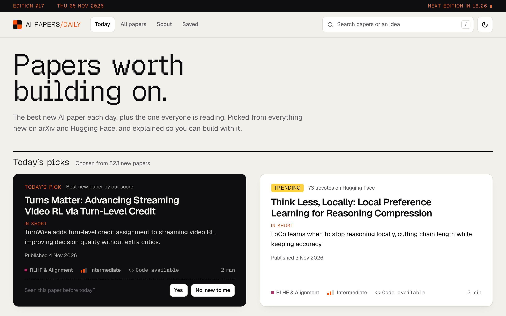
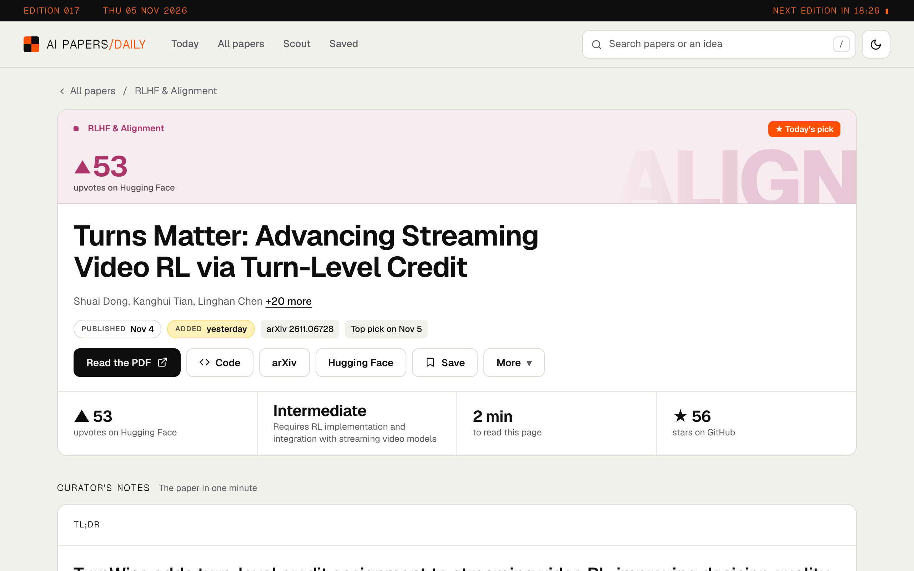
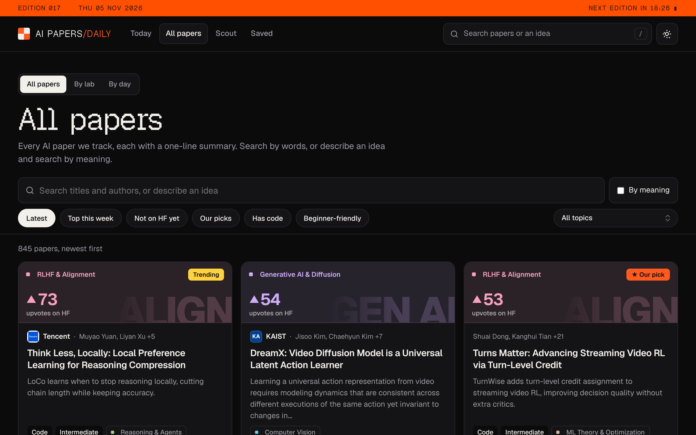
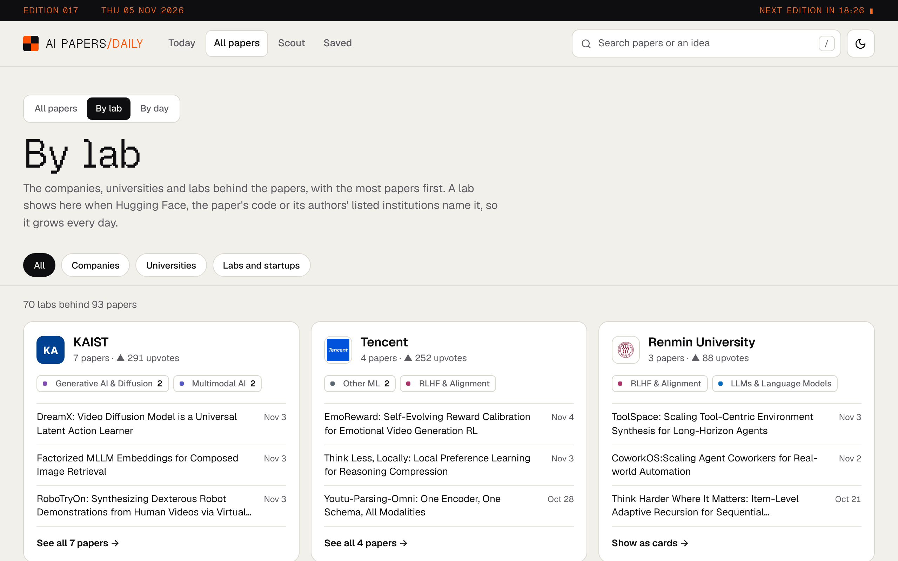
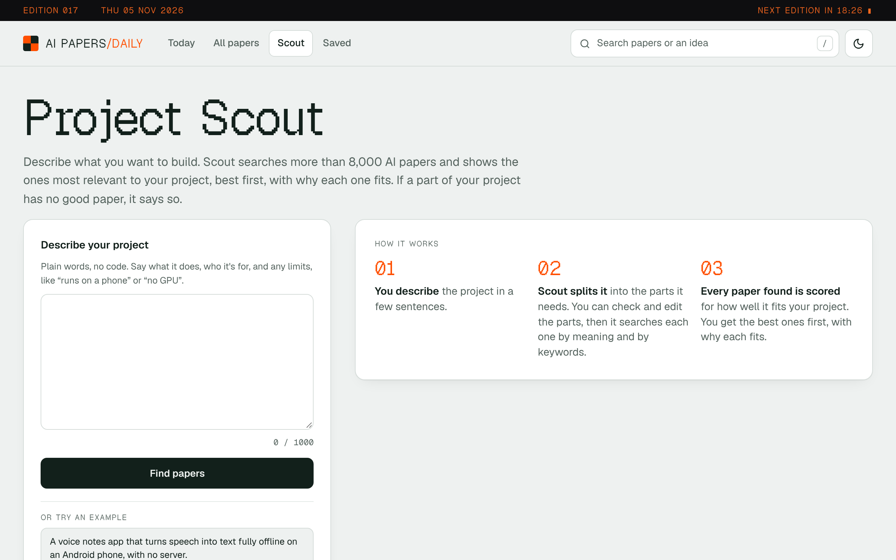
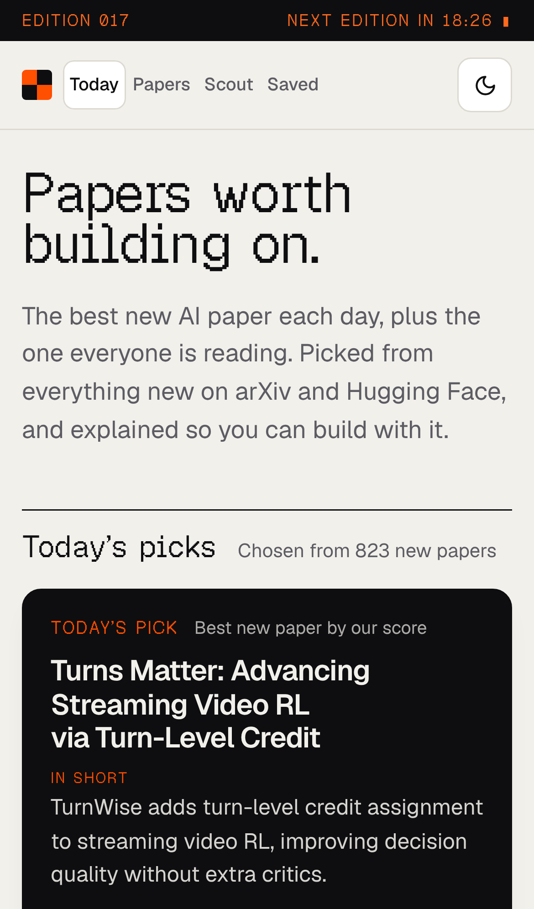
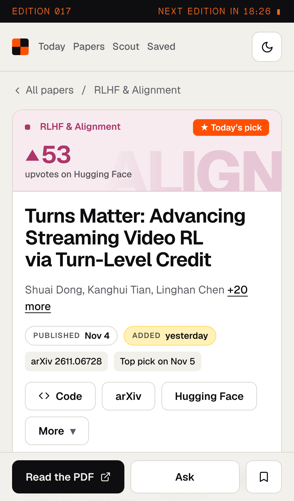
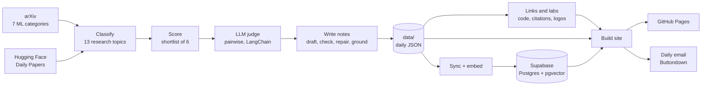

<div align="center">

<a href="https://omen-bit.github.io/ai-paper-daily/">
  
</a>

<h1>AI Papers Daily</h1>

<p><strong>Papers worth building on.</strong><br>
The best new AI paper each day, plus the one everyone is reading,<br>explained so you can build with it.</p>

<p>
  <a href="https://omen-bit.github.io/ai-paper-daily/"></a>
  <a href="https://github.com/Omen-bit/ai-paper-daily/actions/workflows/daily-digest.yml"></a>
  <a href="https://github.com/Omen-bit/ai-paper-daily/actions/workflows/tests.yml"></a>
  
  <a href="LICENSE"></a>
</p>

<h3>
  <a href="https://omen-bit.github.io/ai-paper-daily/">Open the site</a>
  &nbsp;·&nbsp;
  <a href="https://omen-bit.github.io/ai-paper-daily/scout.html">Try Project Scout</a>
  &nbsp;·&nbsp;
  <a href="https://omen-bit.github.io/ai-paper-daily/feed.xml">RSS feed</a>
</h3>

<br>

<picture>
  <source media="(prefers-color-scheme: dark)" srcset="docs/screenshots/home-dark.png">
  
</picture>

</div>

<br>

Hundreds of AI papers land on arXiv every day, and most people never get past the titles.

AI Papers Daily reads all of them every morning and publishes a small edition: **one top pick** chosen by a scoring model, and **one trending paper** the community is upvoting on Hugging Face. Each one is explained in plain words, from a ten-second summary to what you would need to build with it.

Behind the picks sits a library of about a year of AI research, **more than 8,000 papers**, that you can search by meaning, question directly and plan projects from.

<div align="center">
<table>
  <tr>
    <td align="center" width="25%"><h3>2</h3>papers picked<br>every morning</td>
    <td align="center" width="25%"><h3>8,000+</h3>papers to search<br>by meaning</td>
    <td align="center" width="25%"><h3>3</h3>depths of notes<br>for every pick</td>
    <td align="center" width="25%"><h3>07:00 IST</h3>new edition<br>every day</td>
  </tr>
</table>
</div>

## Features

### A page for every paper



- **Notes at three depths.** Switch between *New to this*, *Practitioner* and *Researcher*, then check yourself with a short quiz question.
- **Ask this paper.** Ask a question and get an answer from the full paper, with the section and the exact sentence it relies on. Select any sentence and press **Ask** to ask about it.
- **The full breakdown.** Contributions, results tables, limitations and conclusion, copied straight from the paper.
- **Where it fits.** Citations from Semantic Scholar, the code, models and demos built on it, and the lab that wrote it.

### Search by meaning



Search by idea, not keyword: *"run a model on a phone"* finds quantization and distillation papers even when they never use those words. Narrow the list by topic, or show only this week's top papers, our picks, papers with code, papers not yet on Hugging Face, or beginner-friendly ones.

### Papers by lab



See who is behind each paper, with the lab's own logo, and browse companies, universities, or labs and startups. A lab is only named when Hugging Face, the paper's code or its authors' institutions say so, never guessed from the abstract.

### Project Scout



Describe what you want to build in plain words. Scout splits it into the parts it needs (you can edit them), searches each one by meaning and by keywords, and returns the papers to build on, best first, with one line on why each fits. If part of your project has no good paper, Scout searches once more with better phrases before it says so. Press **Watch this project** to see new papers that match it later.

### And more

| Feature | What it does |
| :-- | :-- |
| **Trends** | A year of AI research in charts: technologies to watch, topic share month by month, momentum by topic and words on the rise. |
| **For you** | Recommendations based on the papers you have opened. |
| **Saved** | Saves, highlights, notes and BibTeX citations, all kept in your browser with no account. |
| **Daily email and RSS** | The top pick and the trending paper in your inbox each morning, or in your feed reader. |
| **Light and dark** | Every page in both themes, and built for phones too. |

<p align="center">
  
  &nbsp;&nbsp;&nbsp;
  
</p>

> [!NOTE]
> Notes and answers are written from the papers by a language model. Check the paper itself before relying on a claim.

## How it works

Every morning at 01:30 UTC (07:00 IST) the **Daily edition** workflow fetches every new paper, picks two, writes their notes, publishes the site to GitHub Pages and emails the edition. It is started on time by [cron-job.org](https://cron-job.org), with GitHub's own schedule at 02:30 UTC as a backup.



The site itself is static. Its live features call **Supabase Edge Functions** straight from the browser:

| Function | Powers | What it does |
| :-- | :-- | :-- |
| `search` | All papers | Finds papers by meaning with vector search |
| `recommend` | For you | Finds papers close to the ones you have read |
| `scout` | Project Scout | A LangGraph agent: splits the project into needs, runs a hybrid search for each, scores every match and says why it fits, then searches again for any need left without a strong paper |
| `ask` | Ask this paper | Reads the full paper from arXiv once, stores it in sections, then answers from the best-matching sections and quotes its source |
| `breakdown` | Paper pages | Copies the contributions, results, limitations and conclusion from the paper once (no LLM), plus a short AI summary for papers without notes |
| `track` | Most read, site numbers | Counts anonymous views, "worth it" votes, clicks on each pick, "seen it before?" answers and returning visitors |
| `embed` | Daily sync | Turns each paper into a `gte-small` vector (pipeline only) |

<details>
<summary><strong>How papers are picked</strong></summary>
<br>

Every point comes from evidence about the paper, never from buzzwords in its abstract:

- **Community.** Hugging Face upvotes on a log scale, 8 points for each doubling.
- **Hand-picked.** Making Hugging Face's Daily Papers list.
- **Code.** Released code, from Hugging Face or a link in the abstract. Worth about one doubling of upvotes.
- **Lab.** A lab named by direct evidence (see below), with more for a well-known one.
- **Cross-over.** A small bonus for papers that span two or more research topics.

The best-scored paper is the pick. The most upvoted of the rest becomes Trending, from a different topic than the pick whenever one has enough upvotes.
Once the site has enough views, the home page shows the week's most read paper in the second slot instead.

The scorer then shortlists its top 6, and an LLM judge compares them two at a time (15 comparisons), judging novelty, evidence, reproducibility and usefulness to builders. The paper that wins the most comparisons is the pick. Without a Groq key, or with `PICK_JUDGE=off`, the best score is the pick. `python scripts/backtest_picker.py --judge` compares the judge with the scorer.

Project Scout runs as a LangGraph.js graph inside its edge function:

```
plan_needs -> retrieve -> fuse -> rank -> respond
                                   |
          a need has no strong paper (first round only): expand_search -> fuse -> rank -> respond
```

The second round searches up to three of the phrases the ranker suggested for the weak needs, scores only the papers the first round hadn't seen, and merges them in. Needs the visitor edited skip `plan_needs`. The page then says "Searched again for: …". The steps live in `_shared/scout_agent.ts` with no network calls, so they are tested with fakes, and the same steps can run without LangGraph (`SCOUT_ENGINE=loop`); Scout also falls back to that on its own if LangGraph fails to load. `scout-spike` measures what LangGraph costs inside an edge function.

Each pick's reading notes come from the Curator, a small LangGraph loop: the model drafts the notes, every field is checked (word limits, required fields, no numbers the abstract lacks), the same model is asked to fix only the fields that failed (up to two rounds), and a smaller model then checks each fact against the abstract. Unsupported optional fields are dropped; an unsupported required field goes back for repair.

By default the picks come from the papers fetched that morning. Set the repository variable `PICK_FROM` to `yesterday` to pick from the previous day's papers instead, once their upvotes have had a day to build up. Run `python scripts/backtest_picker.py --day-late` first to compare the two.

Papers featured in the last seven editions are not picked again. The pipeline reads every new paper in the tracked arXiv categories each day (often over 1,000) and keeps the best 200 in `data/`.

To check how good the picks turn out, `python scripts/backtest_picker.py` replays every saved day and compares each pick with the papers' Hugging Face upvotes a few days later (hit rate in the day's top 10, rank in the pool, and share of the best paper's upvotes).

Each morning `paper_links.py` also gathers citations, code, models and labs into `data/links.json`, and lab logos into `data/logos/`, with no AI. A lab comes from evidence that names it directly: the organization that claimed the paper on Hugging Face, the owner of its GitHub code, the arXiv comment field, or the authors' institutions on OpenAlex. Logos come from Hugging Face, Wikidata, GitHub or the lab's own website.
</details>

<details>
<summary><strong>Is the pick worth reading? How it is measured</strong></summary>
<br>

The site counts, as daily totals with no visitor data:

- clicks on today's pick against clicks on the Trending card,
- answers to "Seen this paper before today?" on each pick,
- visits from new readers, readers back within a week, and readers back after longer.

To read them, run `select * from site_report(28);` in the Supabase SQL editor.
</details>

<details>
<summary><strong>Code review agent</strong></summary>
<br>

Every Monday a GitHub Actions workflow (`code-review-agent.yml`) runs `scripts/code_review_agent.py`, a LangGraph graph:

```
collect -> review -> verify -> dedupe -> file
```

It collects the last 7 days of commits and runs pytest, the Supabase function tests and ruff (bug rules only). The LLM then reads each changed file's diff and lists likely bugs, each naming a line and the code on it. Findings whose code isn't really on that line are dropped, and failing checks rank first. Anything the agent filed before, open or closed, is skipped. It opens at most 3 issues labelled `agent-found`, each with the evidence and a suggested fix, using the workflow's own `GITHUB_TOKEN`. Run the workflow by hand with **dry run** ticked, or `python scripts/code_review_agent.py --dry-run` locally, to see what it would file.
</details>

<details>
<summary><strong>Are Scout and Ask getting better? Eval sets</strong></summary>
<br>

`evals/` holds fixed test sets, so a prompt or model change can be measured before and after:

- `scout_cases.json`: 26 project descriptions, each with the papers in the library that clearly serve it.
- `ask_cases.json`: 30 questions about 6 papers with reference answers, 5 of them questions the paper can't answer.

`python scripts/run_evals.py scout|ask|all` runs them against the live functions and saves the results to `evals/results/`. Scout is scored on whether an expected paper is in the top 10 (hit@10), how high it ranks (MRR), whether it is marked a strong fit, how many of the project's needs come back missing, and how often Scout searched a second round. Ask is scored on whether the answer quotes the paper and whether it is right, graded by an LLM against the reference; for a question the paper can't answer, right means saying so. Add `--langsmith` to log the run as a LangSmith experiment and compare runs side by side. With `SYNC_SECRET` in `.env` the hourly limits are skipped; without it the script paces itself.
</details>

<details>
<summary><strong>Limits and safety</strong></summary>
<br>

- Every public function has a per-visitor hourly limit.
- `embed` only accepts calls carrying the pipeline's `SYNC_SECRET`; calls with it also skip the hourly limits.
- If the LLM is unavailable, Scout still returns its search results, marked as not checked.
- AI summaries in `breakdown` are capped per day; past the cap the page shows the breakdown without one.
- Stored full texts that nobody has asked about for 30 days are removed by the daily run.
</details>

## Tech stack

| Layer | Built with |
| :-- | :-- |
| Pipeline | Python 3.11, [LangGraph](https://langchain-ai.github.io/langgraph/) (the daily run is a StateGraph), arXiv API, Hugging Face Daily Papers, Semantic Scholar, OpenAlex |
| Agents and tracing | LangChain (the pairwise judge, with model fallback), LangGraph.js (Project Scout), a LangGraph code review agent, LangSmith tracing and experiments (optional) |
| Language model | [Groq](https://groq.com) running `gpt-oss-120b`, with `gpt-oss-20b` as fallback |
| Database and search | [Supabase](https://supabase.com) Postgres, pgvector, Edge Functions (Deno, TypeScript) |
| Website | Static HTML, CSS and vanilla JavaScript, hand-drawn SVG charts |
| Email | [Buttondown](https://buttondown.com) |
| Hosting and automation | GitHub Pages, GitHub Actions |

<details>
<summary><strong>Project structure</strong></summary>
<br>

```text
ai-paper-daily/
├── .github/workflows/
│   ├── daily-digest.yml        Daily edition: pick, sync, build, deploy, email
│   ├── supabase-functions.yml  Deploys the Edge Functions
│   ├── supabase-sync.yml       One-time full sync and history backfill
│   └── tests.yml               Python and TypeScript tests on every push
├── src/
│   ├── main.py                 Pipeline entry point
│   ├── pipeline_graph.py       The daily run as a LangGraph graph
│   ├── judge.py                LLM judge: compares the shortlist two at a time
│   ├── fetcher.py              arXiv and Hugging Face fetcher
│   ├── classifier.py           Research topic classifier
│   ├── scorer.py               Scoring: top pick and trending
│   ├── curator.py              Notes for each pick (LangGraph: draft, check, repair, ground)
│   ├── groq_summarizer.py      Groq client with model fallback
│   ├── paper_store.py          Daily JSON records in data/
│   ├── pick_pool.py            Which papers the picks come from (today or yesterday)
│   ├── paper_links.py          Code, models, citations and labs for paper pages
│   ├── labs.py                 Which lab or company wrote each paper
│   ├── lab_logos.py            Each lab's logo, saved in data/logos/
│   ├── supabase_sync.py        Upload, embed and export papers
│   ├── trends.py               Trend maths and SVG charts
│   ├── tech_trends.py          Technologies to watch
│   ├── technologies.py         Technology catalogue
│   ├── site_builder.py         Static site generator
│   ├── discovery.py            RSS feed, sitemap and share images
│   ├── send_newsletter.py      Daily email through Buttondown
│   ├── share_fonts/            Fonts for the share images
│   └── site_assets/            CSS, JavaScript and fonts
├── supabase/
│   ├── schema.sql              Tables, vector search, rate limits
│   ├── functions/              search, recommend, scout (LangGraph.js agent), scout-spike, ask, breakdown, track, embed
│   └── tests/                  Edge Function tests
├── scripts/
│   ├── backtest_picker.py      Replays saved days to measure the picker
│   ├── run_evals.py            Scores Scout and Ask on the eval sets
│   └── code_review_agent.py    Weekly review that opens issues (LangGraph)
├── evals/                      Eval sets for Scout and Ask, and saved results
├── tests/                      Python tests
├── data/                       Daily editions, links and lab logos, updated by the workflow
└── docs/                       Logo and screenshots
```
</details>

## License

Released under the [MIT License](LICENSE).

<div align="center">
<br>
<sub>Data from <a href="https://arxiv.org">arXiv</a> and <a href="https://huggingface.co/papers">Hugging Face</a>. Thank you to arXiv for use of its open access interoperability.</sub>
</div>
