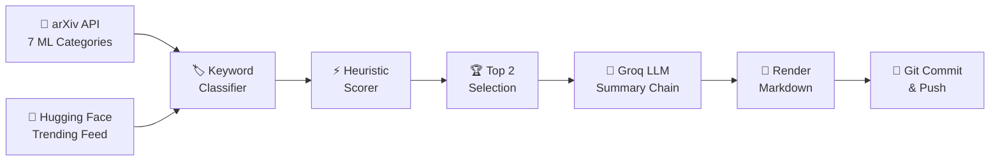

# 🧠 AI Paper Daily

<div align="center">

> **Autonomous AI & Machine Learning Research Intelligence.**  
> Curating the top 2 breakthrough papers every morning — with "Why It Matters" executive summaries, heuristic scoring, and automatic GitHub publishing.

[](https://github.com/Omen-bit/ai-paper-daily/actions/workflows/daily-digest.yml)


[**🔥 Today's Picks**](#-todays-featured-papers) &nbsp;•&nbsp;
[**🏷️ Categories**](#-browse-by-category) &nbsp;•&nbsp;
[**📁 Archive**](#-digest-archive) &nbsp;•&nbsp;
[**📊 Analytics**](#-project-insights) &nbsp;•&nbsp;
[**🛠️ Architecture**](#-system-architecture) &nbsp;•&nbsp;
[**⚙️ Setup**](#-quick-start)

---

</div>

## 🔥 Today's Featured Papers

<!-- TODAY_START -->
### 📅 Today's Featured Papers — [Tuesday, October 20, 2026](digests/2026-10-20.md)

#### 1. [Evidence-First Agentic Verification](https://arxiv.org/abs/2610.17724)
`⭐ Top Pick` `🔥 Trending on HF` `🧠 Reasoning & Agents` `🤖 LLMs & Language Models`

> 💡 **Why It Matters:**  
> Introduces Sauron, an evidence-first agentic verifier that inspects state and execution traces to ensure claims are verified before being used as RL rewards, preventing misleading optimization signals.

👥 **Authors:** Reza Sanayei, Razvan-Gabriel Dumitru, Sunjie Hou et al.  
🔗 **Links:** [📄 arXiv Paper](https://arxiv.org/abs/2610.17724) &nbsp;•&nbsp; [📥 Direct PDF](https://arxiv.org/pdf/2610.17724) &nbsp;•&nbsp; [🤗 Community Discussion](https://huggingface.co/papers/2610.17724)  

#### 2. [Where is Physical RSI capability from? An Observational Scaling Law of LLM-as-policy](https://arxiv.org/abs/2610.26848)
`🔥 Trending on HF` `🔀 Interdisciplinary` `📊 ML Theory & Optimization` `🤖 LLMs & Language Models`

> 💡 **Why It Matters:**  
> Proposes PhysRSI-eval, a five-axis framework to quantify recursive self-improvement in physical environments and formulates the Physical Barrel Hypothesis for LLM agent policies.

👥 **Authors:** Zekai Li, Jiayi Yu, Jinlu Zhang et al.  
🔗 **Links:** [📄 arXiv Paper](https://arxiv.org/abs/2610.26848) &nbsp;•&nbsp; [📥 Direct PDF](https://arxiv.org/pdf/2610.26848) &nbsp;•&nbsp; [🤗 Community Discussion](https://huggingface.co/papers/2610.26848)  

👉 **[Read the Full Markdown Digest with Abstracts →](digests/2026-10-20.md)**
<!-- TODAY_END -->

---

## 🏷️ Browse by Category

Explore past curated papers categorized by research subfield:

| 🤖 Models & Architecture | 🎯 Applied Intelligence | 🔬 Theory & Systems |
| :--- | :--- | :--- |
| [🤖 **LLMs & Language Models**](categories/llms.md) | [🧠 **Reasoning & Agents**](categories/reasoning-agents.md) | [📊 **ML Theory & Scaling**](categories/ml-theory.md) |
| [🎨 **Generative AI & Diffusion**](categories/generative-ai.md) | [🤝 **RLHF & Alignment**](categories/alignment.md) | [📱 **Efficient AI & Quantization**](categories/efficient-ai.md) |
| [👁️ **Computer Vision**](categories/computer-vision.md) | [💻 **Code & Software AI**](categories/code-ai.md) | [🔒 **AI Safety & Alignment**](categories/safety-privacy.md) |
| [🌐 **Multimodal Systems**](categories/multimodal.md) | [🏥 **AI for Science & Health**](categories/ai-science.md) | [🎵 **Audio & Speech**](categories/audio-speech.md) |

---

## 📁 Digest Archive

<!-- ARCHIVE_START -->
### 📁 Digest Archive

| Date | Papers | Top Category Covered | Digest Link |
| :--- | :---: | :--- | :--- |
| **2026-10-20** | `2` | Reasoning & Agents | [📄 Read Digest →](digests/2026-10-20.md) |
<!-- ARCHIVE_END -->

---

## 📊 Analytics & Coverage

<!-- STATS_START -->
### 📊 Project Insights

| Metric | Value |
| :--- | :--- |
| 📄 **Total Research Papers Curated** | **4** |
| 📅 **Total Daily Editions Published** | **2** |
| 🗓️ **Tracking Since** | `2026-10-20` |
| 🔄 **Last Pipeline Execution** | `2026-10-20` |

**🏆 Most Active Research Categories:**

- 🧠 **Reasoning & Agents**: `4` papers
- 🤖 **LLMs & Language Models**: `4` papers
- 🎨 **Generative AI & Diffusion**: `2` papers
- 📊 **ML Theory & Optimization**: `2` papers
<!-- STATS_END -->

---

## 🛠️ System Architecture

Every morning at **06:30 UTC (12:00 IST)**, GitHub Actions wakes up a serverless runner and executes the pipeline:



### ⚡ Ranking Signals
- **Community Momentum:** HuggingFace upvotes, community bookmark velocity.
- **Novelty Detection:** Title/Abstract keyword markers (*breakthrough, SOTA, novel, introduce*).
- **Interdisciplinary Cross-over:** Multi-category convergence (e.g. LLMs + Robotics).
- **Synthesis Impact:** Comprehensive surveys, position papers, and landmark benchmarks.

---

## ⚙️ Quick Start (Fork & Run)

Want to run this automated digest for your own profile?

1. **Fork this repository** to your GitHub account.
2. **Obtain a free Groq API key** from [console.groq.com](https://console.groq.com) (free tier includes 30 RPM).
3. **Save your secret**:
   - Go to your repo: `Settings → Secrets and variables → Actions`
   - Add a new secret named `GROQ_API_KEY`
4. **Trigger workflow manually**:
   - Navigate to `Actions → 🧠 Daily AI Paper Digest → Run workflow`
5. That's it! GitHub Actions will run every single morning automatically and record green commits on your heatmap.

---

## 📂 Repository Layout

```text
ai-paper-daily/
├── .github/workflows/
│   └── daily-digest.yml      # Automated 06:30 UTC cron workflow
├── src/                      # Modular Python pipeline
│   ├── classifier.py         # Multi-label research category classifier
│   ├── fetcher.py            # arXiv & HuggingFace API scraper
│   ├── groq_summarizer.py    # Multi-model LLM fallback summarizer
│   ├── readme_updater.py     # Live README section manager
│   ├── renderer.py           # Markdown digest & category page builder
│   ├── scorer.py             # Paper scoring heuristics & status badges
│   └── stats_tracker.py      # Cumulative analytics & JSON storage
├── digests/                  # Published daily edition markdown files
├── categories/               # Dedicated archive per research field
├── stats/                    # stats.json persistent dataset
├── main.py                   # Pipeline launcher
├── requirements.txt          # Python dependencies
└── README.md                 # Public project dashboard
```

---

<div align="center">

*Engineered with Python · Powered by [arXiv](https://arxiv.org) · [Hugging Face](https://huggingface.co) · [Groq](https://groq.com) · [GitHub Actions](https://github.com/features/actions)*

</div>
