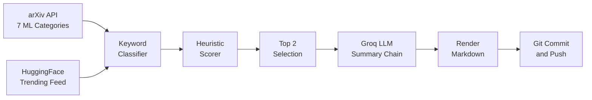

# 🧠 AI Paper Daily

<div align="center">

> **Autonomous AI & Machine Learning Research Intelligence.**
> Curating the top 2 breakthrough papers every morning, with "Why It Matters" summaries, heuristic scoring, and automatic GitHub publishing.

[](https://github.com/Omen-bit/ai-paper-daily/actions/workflows/daily-digest.yml)
[](https://github.com/Omen-bit/ai-paper-daily/actions/workflows/tests.yml)


[**Today's Picks**](#-todays-featured-papers) &nbsp;•&nbsp;
[**Categories**](#-browse-by-category) &nbsp;•&nbsp;
[**Archive**](#-digest-archive) &nbsp;•&nbsp;
[**Analytics**](#-analytics--coverage) &nbsp;•&nbsp;
[**Architecture**](#-system-architecture) &nbsp;•&nbsp;
[**Setup**](#-quick-start-fork--run)

---

</div>

## 🔥 Today's Featured Papers

<!-- TODAY_START -->
### Tuesday, October 20, 2026 -- [2026-10-20](digests/2026-10-20.md)

#### 1. [Evidence-First Agentic Verification](https://arxiv.org/abs/2610.17724)
`⭐ Top Pick` `🔥 Trending on HF` `🧠 Reasoning & Agents` `🤖 LLMs & Language Models`

<<<<<<< HEAD
> **Why It Matters:**
> Introduces Sauron, an evidence-first agentic verifier that inspects state and execution traces to ensure claims are verified before being used as RL rewards, preventing misleading optimization signals.
=======
> 💡 **Why It Matters:**  
> We introduce Sauron, an evidence-first agentic verifier that investigates both state and trace and relies on a claim only after independently validating it against its source.
>>>>>>> 0e23053e6a40ac7d742604784f44bdd31101a1ab

**Authors:** Reza Sanayei, Razvan-Gabriel Dumitru, Sunjie Hou et al.
**Links:** [arXiv Paper](https://arxiv.org/abs/2610.17724) &nbsp;|&nbsp; [Direct PDF](https://arxiv.org/pdf/2610.17724) &nbsp;|&nbsp; [HF Community](https://huggingface.co/papers/2610.17724)

#### 2. [Where is Physical RSI capability from? An Observational Scaling Law of LLM-as-policy](https://arxiv.org/abs/2610.26848)
`🔥 Trending on HF` `🔀 Interdisciplinary` `📊 ML Theory & Optimization` `🤖 LLMs & Language Models`

<<<<<<< HEAD
> **Why It Matters:**
> Proposes PhysRSI-eval, a five-axis framework to quantify recursive self-improvement in physical environments and formulates the Physical Barrel Hypothesis for LLM agent policies.
=======
> 💡 **Why It Matters:**  
> We introduce PhysRSI-eval to quantify physical RSI through a five-axis metric: First-Attempt Performance, Efficiency, Success, Budget and Improvement from failure.
>>>>>>> 0e23053e6a40ac7d742604784f44bdd31101a1ab

**Authors:** Zekai Li, Jiayi Yu, Jinlu Zhang et al.
**Links:** [arXiv Paper](https://arxiv.org/abs/2610.26848) &nbsp;|&nbsp; [Direct PDF](https://arxiv.org/pdf/2610.26848) &nbsp;|&nbsp; [HF Community](https://huggingface.co/papers/2610.26848)

**[Read the full digest with abstracts](digests/2026-10-20.md)**
<!-- TODAY_END -->

---

## 🏷️ Browse by Category

Explore past curated papers categorized by research subfield:

| Models & Architecture | Applied Intelligence | Theory & Systems |
| :--- | :--- | :--- |
| [🤖 **LLMs & Language Models**](categories/llms.md) | [🧠 **Reasoning & Agents**](categories/reasoning-agents.md) | [📊 **ML Theory & Scaling**](categories/ml-theory.md) |
| [🎨 **Generative AI & Diffusion**](categories/generative-ai.md) | [🤝 **RLHF & Alignment**](categories/alignment.md) | [📱 **Efficient AI & Quantization**](categories/efficient-ai.md) |
| [👁️ **Computer Vision**](categories/computer-vision.md) | [💻 **Code & Software AI**](categories/code-ai.md) | [🔒 **AI Safety & Privacy**](categories/safety-privacy.md) |
| [🌐 **Multimodal AI**](categories/multimodal.md) | [🏥 **AI for Science & Health**](categories/ai-science.md) | [🎵 **Audio & Speech**](categories/audio-speech.md) |
| [🔖 **Other ML**](categories/other-ml.md) | | |

---

## 📁 Digest Archive

<!-- ARCHIVE_START -->
| Date | Papers | Top Category | Digest |
| :--- | :---: | :--- | :--- |
| **2026-10-20** | `2` | Reasoning & Agents | [Read digest](digests/2026-10-20.md) |
<!-- ARCHIVE_END -->

---

## 📊 Analytics & Coverage

<!-- STATS_START -->
| Metric | Value |
| :--- | :--- |
<<<<<<< HEAD
| Papers curated | **2** |
| Daily editions | **1** |
| Tracking since | `2026-10-20` |
| Last run | `2026-10-20` |
=======
| 📄 **Total Research Papers Curated** | **6** |
| 📅 **Total Daily Editions Published** | **3** |
| 🗓️ **Tracking Since** | `2026-10-20` |
| 🔄 **Last Pipeline Execution** | `2026-10-20` |
>>>>>>> 0e23053e6a40ac7d742604784f44bdd31101a1ab

**Most active categories:**

<<<<<<< HEAD
- 🧠 **Reasoning & Agents**: `2` papers
- 🤖 **LLMs & Language Models**: `2` papers
=======
- 🧠 **Reasoning & Agents**: `6` papers
- 🤖 **LLMs & Language Models**: `6` papers
- 🎨 **Generative AI & Diffusion**: `3` papers
- 📊 **ML Theory & Optimization**: `3` papers
>>>>>>> 0e23053e6a40ac7d742604784f44bdd31101a1ab
<!-- STATS_END -->

---

## 🛠️ System Architecture

Every morning at **06:30 UTC (12:00 IST)**, GitHub Actions runs the pipeline:



### Ranking Signals
- **Community Momentum:** HuggingFace upvotes and community bookmark velocity.
- **Novelty Detection:** Title/Abstract keyword markers (*breakthrough, SOTA, novel, introduce*).
- **Interdisciplinary Cross-over:** Multi-category convergence (e.g. LLMs + Robotics).
- **Synthesis Impact:** Comprehensive surveys, position papers, and landmark benchmarks.

---

## ⚙️ Quick Start (Fork & Run)

Want to run this automated digest for your own profile?

1. **Fork this repository** to your GitHub account.
2. **Obtain a free Groq API key** from [console.groq.com](https://console.groq.com) (free tier includes 30 RPM).
3. **Save your secret**:
   - Go to your repo: `Settings > Secrets and variables > Actions`
   - Add a new secret named `GROQ_API_KEY`
4. **Trigger workflow manually**:
   - Navigate to `Actions > Daily AI Paper Digest > Run workflow`
5. That's it! GitHub Actions will run every morning automatically.

For local runs, copy `.env.example` to `.env`, fill in your key, and run `python src/main.py`.

---

## 📂 Repository Layout

```text
ai-paper-daily/
├── .github/workflows/
│   ├── daily-digest.yml      # Automated 06:30 UTC daily runner
│   └── tests.yml             # Runs pytest on push and pull request
├── src/                      # All pipeline code
│   ├── main.py               # Pipeline orchestrator and entrypoint
│   ├── classifier.py         # 12-category research classifier
│   ├── fetcher.py            # arXiv and HuggingFace API fetcher
│   ├── groq_summarizer.py    # LLM summarizer with fallback chain
│   ├── readme_updater.py     # Live README section manager
│   ├── renderer.py           # Markdown digest and category builder
│   ├── scorer.py             # Heuristic scoring and status badges
│   └── stats_tracker.py      # Cumulative JSON analytics manager
├── tests/                    # Pytest test suite
├── digests/                  # Published daily edition markdown files
├── categories/               # Dedicated archive per research field
├── stats/                    # stats.json persistent dataset
├── requirements.txt          # Runtime dependencies (pinned)
├── requirements-dev.txt      # Dev/test dependencies
├── .env.example              # Template for local environment variables
└── README.md                 # Public project dashboard
```

---

<div align="center">

*Engineered with Python · Powered by [arXiv](https://arxiv.org) · [Hugging Face](https://huggingface.co) · [Groq](https://groq.com) · [GitHub Actions](https://github.com/features/actions)*

</div>
