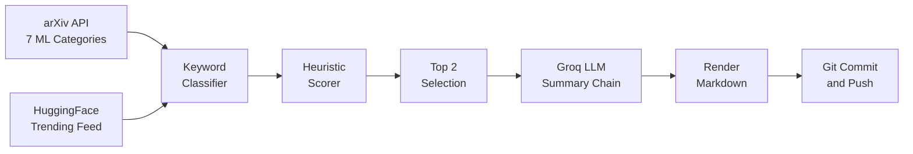

# 🧠 AI Paper Daily

<div align="center">

> **Autonomous AI & Machine Learning Research Intelligence.**
> Curating the top 2 breakthrough papers daily at 07:00 AM IST, with "Why It Matters" summaries, heuristic scoring, and automatic GitHub publishing.

[](https://github.com/Omen-bit/ai-paper-daily/actions/workflows/daily-digest.yml)


[**Today's Picks**](#-todays-featured-papers) &nbsp;•&nbsp;
[**Categories**](#-browse-by-category) &nbsp;•&nbsp;
[**Archive**](#-digest-archive) &nbsp;•&nbsp;
[**Analytics**](#-analytics--coverage) &nbsp;•&nbsp;
[**Architecture**](#-system-architecture) &nbsp;•&nbsp;
[**Repository Layout**](#-repository-layout)

---

</div>

## 🔥 Today's Featured Papers

<!-- TODAY_START -->
### Friday, October 23, 2026 · [2026-10-23](digests/2026-10-23.md)

#### 1. [Editing Images into Reusable Layers via Compositional Edit-Prior Distillation](https://arxiv.org/abs/2610.24738)
`⭐ Top Pick` `🔥 Trending on HF` `🔖 Other ML`

> 💡 **Abstract highlight:**  
> To this end, we introduce LayerEditor, a unified framework that couples instruction-guided image editing with controllable generation of reusable RGBA layers.

**Authors:** Wen Xue, Yong Liu, Xueheng Li et al.  
**Links:** [arXiv Paper](https://arxiv.org/abs/2610.24738) &nbsp;|&nbsp; [Direct PDF](https://arxiv.org/pdf/2610.24738) &nbsp;|&nbsp; [HF Community](https://huggingface.co/papers/2610.24738)  

#### 2. [What Generation Knows: Unlocking Fine-Grained Understanding in Unified Multimodal Models](https://arxiv.org/abs/2610.23987)
`🔥 Trending on HF` `📖 Survey / Review` `🔖 Other ML`

> 💡 **Abstract highlight:**  
> However, existing generation-assisted understanding methods mainly rely on generative supervision or explicit generation and have not systematically explored direct use of native generation-side repre

**Authors:** Tengju Ru, Weitong Lian, Zecong Tang et al.  
**Links:** [arXiv Paper](https://arxiv.org/abs/2610.23987) &nbsp;|&nbsp; [Direct PDF](https://arxiv.org/pdf/2610.23987) &nbsp;|&nbsp; [HF Community](https://huggingface.co/papers/2610.23987)  

**[Read the full digest with abstracts](digests/2026-10-23.md)**
<!-- TODAY_END -->

---

## 🏷️ Browse by Category

Explore past curated papers categorized by research subfield:

| Models & Architecture | Applied Intelligence | Theory & Systems |
| :--- | :--- | :--- |
| [🤖 **LLMs & Language Models**](categories/llms.md) | [🧠 **Reasoning & Agents**](categories/reasoning-agents.md) | [📊 **ML Theory & Scaling**](categories/ml-theory.md) |
| [🎨 **Generative AI & Diffusion**](categories/generative-ai.md) | [🤝 **RLHF & Alignment**](categories/alignment.md) | [📱 **Efficient AI & Quantization**](categories/efficient-ai.md) |
| [👁️ **Computer Vision**](categories/computer-vision.md) | [💻 **Code & Software AI**](categories/code-ai.md) | [🔒 **AI Safety & Privacy**](categories/safety-privacy.md) |
| [🌐 **Multimodal AI**](categories/multimodal.md) | [🏥 **AI for Science & Health**](categories/ai-science.md) | [🎵 **Audio & Speech**](categories/audio-speech.md) |
| [🔖 **Other ML**](categories/other-ml.md) | | |

---

## 📁 Digest Archive

<!-- ARCHIVE_START -->
| Date | Papers | Top Category | Digest |
| :--- | :---: | :--- | :--- |
| **2026-10-23** | `2` | Other ML | [Read digest](digests/2026-10-23.md) |
| **2026-10-22** | `2` | Other ML | [Read digest](digests/2026-10-22.md) |
| **2026-10-21** | `2` | Other ML | [Read digest](digests/2026-10-21.md) |
| **2026-10-20** | `2` | Reasoning & Agents | [Read digest](digests/2026-10-20.md) |
<!-- ARCHIVE_END -->

---

## 📊 Analytics & Coverage

<!-- STATS_START -->
| Metric | Value |
| :--- | :--- |
| Papers curated | **8** |
| Daily editions | **4** |
| Tracking since | `2026-10-20` |
| Last run | `2026-10-23` |

**Most active categories:**

- 🔖 **Other ML**: `6` papers
- 🧠 **Reasoning & Agents**: `1` paper
- 📊 **ML Theory & Optimization**: `1` paper
<!-- STATS_END -->

---

## 🛠️ System Architecture

Every morning at **01:30 UTC (07:00 AM IST)**, GitHub Actions runs the pipeline:



### Ranking Signals
- **Community Momentum:** HuggingFace upvotes and community bookmark velocity.
- **Novelty Detection:** Title/Abstract keyword markers (*breakthrough, SOTA, novel, introduce*).
- **Interdisciplinary Cross-over:** Multi-category convergence (e.g. LLMs + Robotics).
- **Synthesis Impact:** Comprehensive surveys, position papers, and landmark benchmarks.

---

## 📂 Repository Layout

```text
ai-paper-daily/
├── .github/workflows/
│   └── daily-digest.yml      # Automated 01:30 UTC (07:00 AM IST) daily runner
├── src/                      # All pipeline code
│   ├── main.py               # Pipeline orchestrator and entrypoint
│   ├── classifier.py         # 12-category research classifier
│   ├── fetcher.py            # arXiv and HuggingFace API fetcher
│   ├── groq_summarizer.py    # LLM summarizer with fallback chain
│   ├── readme_updater.py     # Live README section manager
│   ├── renderer.py           # Markdown digest and category builder
│   ├── scorer.py             # Heuristic scoring and status badges
│   └── stats_tracker.py      # Cumulative JSON analytics manager
├── digests/                  # Published daily edition markdown files
├── categories/               # Dedicated archive per research field
├── stats/                    # stats.json + last_run.txt
├── requirements.txt          # Runtime dependencies (pinned)
├── LICENSE                   # MIT License
└── README.md                 # Public project dashboard
```

---

<div align="center">

*Engineered with Python · Powered by [arXiv](https://arxiv.org) · [Hugging Face](https://huggingface.co) · [Groq](https://groq.com) · [GitHub Actions](https://github.com/features/actions)*

</div>
