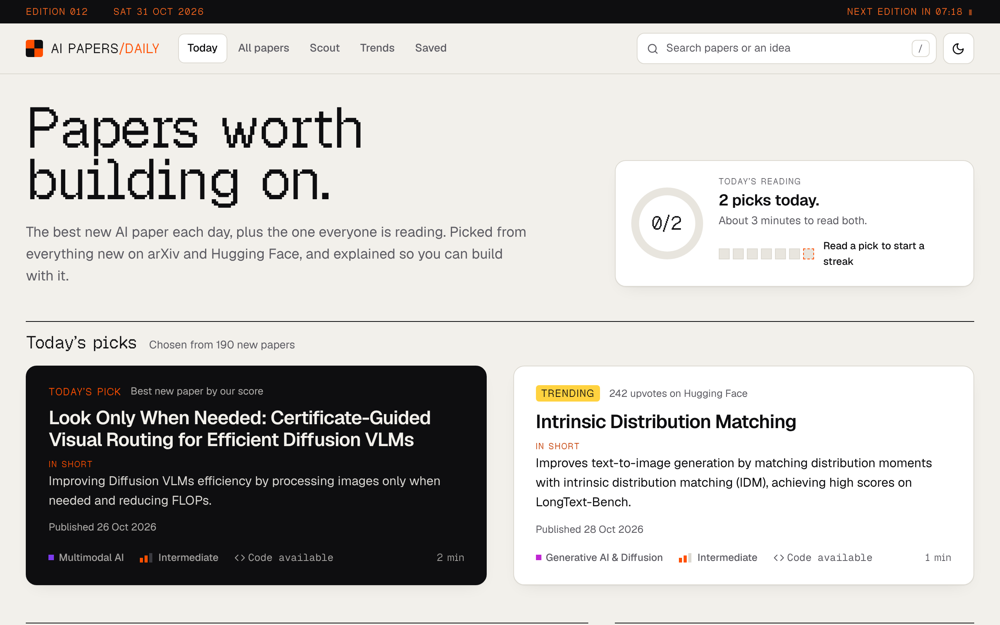
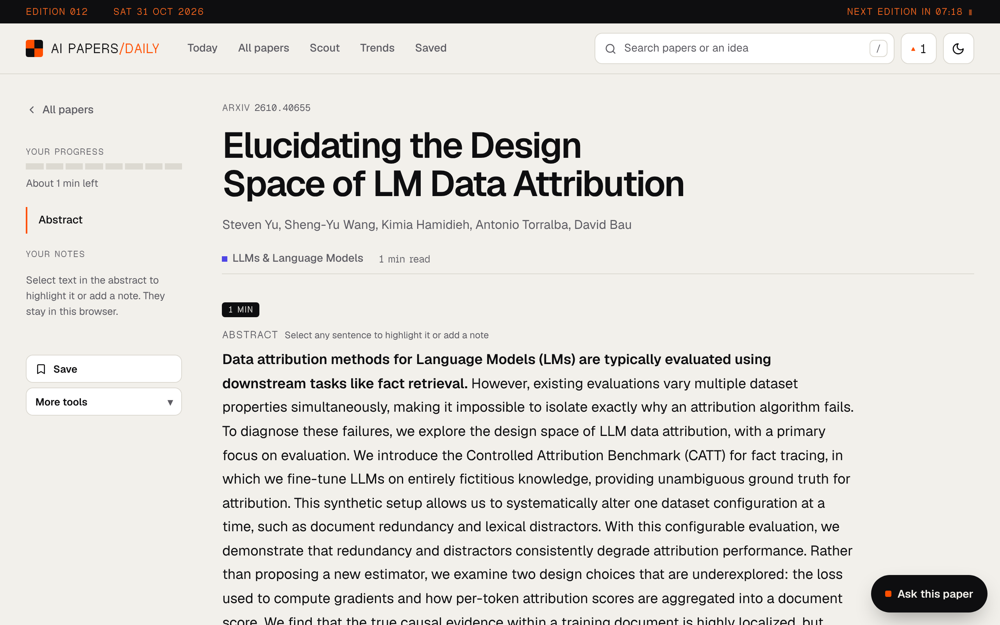
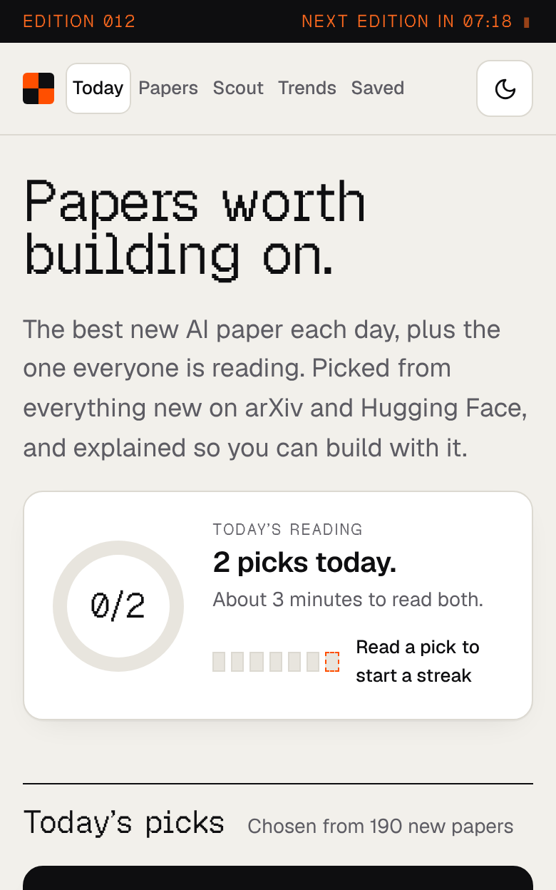
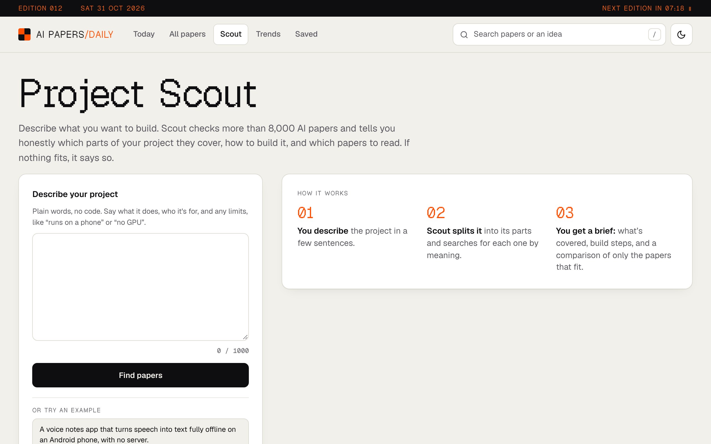
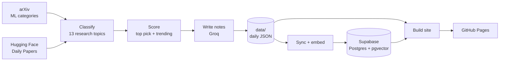

<div align="center">

<a href="https://omen-bit.github.io/ai-paper-daily/">
  
</a>

<h1>AI Papers Daily</h1>

<p><strong>The best new AI paper each day, plus the one everyone is reading,<br>explained so you can build with it.</strong></p>

<p>
  <a href="https://omen-bit.github.io/ai-paper-daily/"></a>
  <a href="https://github.com/Omen-bit/ai-paper-daily/actions/workflows/daily-digest.yml"></a>
  <a href="https://github.com/Omen-bit/ai-paper-daily/actions/workflows/tests.yml"></a>
  <a href="https://github.com/Omen-bit/ai-paper-daily/actions/workflows/supabase-functions.yml"></a>
  
  <a href="LICENSE"></a>
</p>

<p>
  <a href="https://omen-bit.github.io/ai-paper-daily/"><strong>Open the site</strong></a>
  &nbsp;&middot;&nbsp;
  <a href="#features">Features</a>
  &nbsp;&middot;&nbsp;
  <a href="#how-it-works">How it works</a>
  &nbsp;&middot;&nbsp;
  <a href="#run-it-yourself">Run it yourself</a>
</p>

<br>

<picture>
  <source media="(prefers-color-scheme: dark)" srcset="docs/screenshots/home-dark.png">
  
</picture>

</div>

<br>

## About

Hundreds of AI papers land on arXiv every day. Most people never get past the titles.

AI Papers Daily reads all of them every morning and publishes a small edition: **one top pick** chosen by a scoring model, and **one trending paper** the community is upvoting on Hugging Face. Each pick comes with plain-language notes at three depths, from a ten-second summary to what you would need to build with it.

Behind the daily picks sits a searchable library of about a year of AI research, more than 8,000 papers, that you can search by meaning, question directly, and plan projects from.

> [!NOTE]
> Notes and answers are generated from the papers by a language model. Check the paper itself before relying on a claim.

## Features

<table>
  <tr>
    <td width="50%" valign="top">
      <h3>Today's picks</h3>
      The best new paper by score, plus the trending or most-read one. Notes in three depths: ten seconds, one minute, and "build with it". Each card shows when the paper actually came out.
    </td>
    <td width="50%" valign="top">
      <h3>Ask this paper</h3>
      Ask a question beside the text and get an answer from the full paper, with the section and the exact sentence it relies on. Select any sentence and press <b>Ask</b> to ask about it.
    </td>
  </tr>
  <tr>
    <td valign="top">
      <h3>Project Scout</h3>
      Describe what you want to build in plain words. Scout searches the library from several angles and returns an honest reading plan: start here, build on these, go further.
    </td>
    <td valign="top">
      <h3>Trends</h3>
      A year of AI research in charts: the technologies to watch, topic share month by month, momentum by topic, words on the rise, and how your reading compares with the field.
    </td>
  </tr>
  <tr>
    <td valign="top">
      <h3>Search by meaning</h3>
      Search by idea, not keyword. "Run a model on a phone" finds quantization and distillation papers even when they never use those words.
    </td>
    <td valign="top">
      <h3>For you and reading tools</h3>
      Recommendations from what you have opened, plus saves, highlights, notes, BibTeX citations and reading streaks. Everything stays in your browser, with no account.
    </td>
  </tr>
</table>

<table>
  <tr>
    <td width="72%"></td>
    <td width="28%"></td>
  </tr>
  <tr>
    <td colspan="2"></td>
  </tr>
</table>

## How it works

Every morning at 01:30 UTC (07:00 IST) a GitHub Actions workflow builds the day's edition and publishes the site to GitHub Pages.



The site itself is static. Its live features call **Supabase Edge Functions** directly from the browser:

| Function | Powers | What it does |
| :-- | :-- | :-- |
| `search` | Search, All papers | Finds papers by meaning with vector search |
| `recommend` | For you | Finds papers close to the ones you have read |
| `scout` | Project Scout | Plans several searches with an LLM, matches papers and orders them into a reading plan |
| `ask` | Ask this paper | Reads the full paper from arXiv once, stores it in sections, then answers from the best-matching sections and quotes its source |
| `track` | Most read | Counts anonymous views and "worth it" votes |
| `embed` | Daily sync | Turns each paper into a `gte-small` vector (pipeline only) |

<details>
<summary><strong>How papers are ranked</strong></summary>
<br>

- **Community momentum.** Hugging Face upvotes. The most upvoted paper of the day becomes Trending.
- **Novelty.** Signals in the title and abstract that the paper introduces something new.
- **Cross-over.** Papers that span several research topics.
- **Builder value.** Released code, benchmarks, surveys and position papers.
- **Readers.** Once the site has enough views, the week's most read paper takes the second slot.

Papers featured in the last seven editions are not picked again.
</details>

<details>
<summary><strong>Limits and safety</strong></summary>
<br>

- Every public function has a per-visitor hourly limit.
- `embed` only accepts calls carrying the pipeline's `SYNC_SECRET`.
- If the LLM is unavailable, Scout falls back to plain search.
- Stored full texts that nobody has asked about for 30 days are removed by the daily run.
</details>

## Tech stack

| Layer | Built with |
| :-- | :-- |
| Pipeline | Python 3.11, arXiv API, Hugging Face Daily Papers |
| Language model | [Groq](https://groq.com) running `gpt-oss-120b`, with `gpt-oss-20b` as fallback |
| Database and search | [Supabase](https://supabase.com) Postgres, pgvector, Edge Functions (Deno, TypeScript) |
| Website | Static HTML, CSS and vanilla JavaScript, hand-drawn SVG charts |
| Hosting and automation | GitHub Pages, GitHub Actions |

## Run it yourself

<details>
<summary><strong>Deploy your own copy</strong></summary>
<br>

1. Fork the repository and set GitHub Pages to **Source: GitHub Actions**.
2. Get a free API key from the [Groq console](https://console.groq.com).
3. Create a [Supabase](https://supabase.com) project and run `supabase/schema.sql` in its SQL editor. Running it again later is safe.
4. Add these repository secrets under **Settings > Secrets and variables > Actions**:

   | Secret | Where it comes from |
   | :-- | :-- |
   | `GROQ_API_KEY` | Groq console |
   | `SUPABASE_URL` | Supabase > Project settings > API |
   | `SUPABASE_SECRET_KEY` | Supabase > Project settings > API keys |
   | `SUPABASE_PROJECT_REF` | The id in your Supabase project URL |
   | `SUPABASE_ACCESS_TOKEN` | Supabase > Account > Access tokens |
   | `SYNC_SECRET` | Any long random string |

5. Add `GROQ_API_KEY` and `SYNC_SECRET` as Supabase secrets too (**Edge Functions > Secrets**).
6. Run **Deploy Supabase functions**, then **Full sync to Supabase** once to load a year of papers. After that, **Daily edition** runs every morning by itself.

Without Supabase the daily edition and site still work; search, Scout, Ask, For you and Most read need it.

To use different Groq models, set a `GROQ_MODELS` repository variable (or Supabase secret) to a comma-separated list, best first.
</details>

<details>
<summary><strong>Develop locally</strong></summary>
<br>

```bash
cp .env.example .env                  # add your GROQ_API_KEY
pip install -r requirements-dev.txt

python src/main.py                    # pick today's papers into data/
python src/site_builder.py            # build the site into site/
python -m http.server -d site 8000    # preview at http://localhost:8000

python -m pytest                                              # Python tests
node --experimental-strip-types --test supabase/tests/*.test.ts  # function tests
```
</details>

## Project structure

```text
ai-paper-daily/
├── .github/workflows/
│   ├── daily-digest.yml        Daily edition: pick, sync, build, deploy
│   ├── supabase-functions.yml  Deploys the Edge Functions
│   ├── supabase-sync.yml       One-time full sync and history backfill
│   └── tests.yml               Python and TypeScript tests on every push
├── src/
│   ├── main.py                 Pipeline entry point
│   ├── fetcher.py              arXiv and Hugging Face fetcher
│   ├── classifier.py           Research topic classifier
│   ├── scorer.py               Scoring: top pick and trending
│   ├── curator.py              Notes for each pick
│   ├── groq_summarizer.py      Groq client with model fallback
│   ├── paper_store.py          Daily JSON records in data/
│   ├── supabase_sync.py        Upload, embed and export papers
│   ├── trends.py               Trend maths and SVG charts
│   ├── tech_trends.py          Technologies to watch
│   ├── technologies.py         Technology catalogue
│   ├── site_builder.py         Static site generator
│   └── site_assets/            CSS, JavaScript and fonts
├── supabase/
│   ├── schema.sql              Tables, vector search, rate limits
│   ├── functions/              search, recommend, scout, ask, track, embed
│   └── tests/                  Edge Function tests
├── tests/                      Python tests
├── data/                       Daily editions as JSON, updated by the workflow
└── docs/                       Logo and screenshots
```

## License

Released under the [MIT License](LICENSE).

<div align="center">
<br>
<sub>Data from <a href="https://arxiv.org">arXiv</a> and <a href="https://huggingface.co/papers">Hugging Face</a>. Thank you to arXiv for use of its open access interoperability.</sub>
</div>
