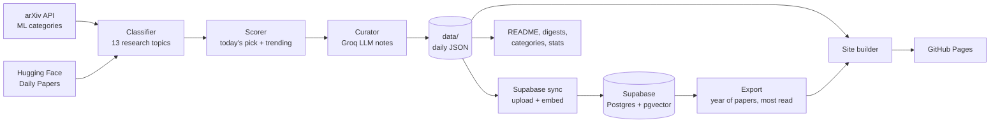

# 🧠 AI Papers Daily

<div align="center">

**The best new AI paper each day, plus the one everyone is reading, explained so you can build with it.**

### [Open the site →](https://omen-bit.github.io/ai-paper-daily/)

[](https://github.com/Omen-bit/ai-paper-daily/actions/workflows/daily-digest.yml)
[](https://github.com/Omen-bit/ai-paper-daily/actions/workflows/supabase-functions.yml)


[**What's inside**](#-whats-inside) &nbsp;•&nbsp;
[**Today's picks**](#-todays-featured-papers) &nbsp;•&nbsp;
[**Archive**](#-digest-archive) &nbsp;•&nbsp;
[**How it works**](#-how-it-works) &nbsp;•&nbsp;
[**Run your own**](#-run-your-own) &nbsp;•&nbsp;
[**Repository layout**](#-repository-layout)


---

</div>

Every morning the pipeline reads everything new on arXiv and Hugging Face Daily Papers, scores it, and publishes a small edition: **one top pick** chosen by our score and **one trending paper** the community is upvoting (or, once enough people read on the site, the **most read** paper of the week). Each pick gets plain-language notes: what's new, the key result, why it matters, and what you'd need to try it.

Around those daily picks sits a database of about a year of AI papers (8,000+), searchable by meaning.

## ✨ What's inside

| | Feature | What it does |
| :---: | :--- | :--- |
| ⭐ | **Today's picks** | The best new paper by our score, plus the trending or most-read one. Notes in three depths: 10 seconds, 1 minute, and "build with it". |
| 💬 | **Ask this paper** | Ask a question beside the text and get an answer from the full paper, with the section and sentence it relies on. The first question on a paper reads it from arXiv (a few seconds); after that answers are instant. Select any sentence and press **Ask** to ask about it. |
| 🧭 | **Project Scout** | Describe what you want to build in plain words. Scout searches the whole database from several angles and returns a short reading plan: start here, build on these, read later. |
| 🎯 | **For you** | Recommendations from the papers you opened, worked out in your browser. No account needed. |
| 📈 | **Trends** | A year of AI research in charts: topic share by month, rising and falling topics, words on the rise, how much research ships code, and how your reading compares with the field. |
| 🔎 | **Search by meaning** | Search all papers by idea, not just keywords ("run a model on a phone" finds quantization papers). |
| 🔖 | **Reading tools** | Save papers, highlight and take notes, cite in BibTeX, focus mode, reading streaks. All stored in your browser. |

<table>
<tr>
<td width="62%"></td>
<td width="38%"></td>
</tr>
<tr>
<td colspan="2"></td>
</tr>
</table>

> The papers, notes and answers are generated from public abstracts. Always check the paper itself before relying on a claim.

---

## 🔥 Today's Featured Papers

<!-- TODAY_START -->
### Saturday, October 31, 2026 · [2026-10-31](digests/2026-10-31.md)

#### 1. [Look Only When Needed: Certificate-Guided Visual Routing for Efficient Diffusion VLMs](https://arxiv.org/abs/2610.36671)
`⭐ Top Pick` `🔥 Trending on HF` `🌐 Multimodal AI` `🤖 LLMs & Language Models` `97 HF upvotes`

> 💡 **Why It Matters:**  
> Efficiently utilizing visual information in Diffusion VLMs.

**Authors:** Donghyeon Cho, Joowon Kim, Seungho Shin et al.  
**Links:** [arXiv Paper](https://arxiv.org/abs/2610.36671) &nbsp;|&nbsp; [Direct PDF](https://arxiv.org/pdf/2610.36671) &nbsp;|&nbsp; [HF Community](https://huggingface.co/papers/2610.36671)  

#### 2. [Intrinsic Distribution Matching](https://arxiv.org/abs/2610.39633)
`🔥 Trending` `🔥 Trending on HF` `🎨 Generative AI & Diffusion` `📱 Efficient AI & Edge` `243 HF upvotes`

> 💡 **Why It Matters:**  
> Helps builders improve text-to-image generation quality.

**Authors:** Deyuan Liu, Yansen Han, Kaiwen Zheng et al.  
**Links:** [arXiv Paper](https://arxiv.org/abs/2610.39633) &nbsp;|&nbsp; [Direct PDF](https://arxiv.org/pdf/2610.39633) &nbsp;|&nbsp; [HF Community](https://huggingface.co/papers/2610.39633)  

**[Read the full digest with abstracts](digests/2026-10-31.md)**
<!-- TODAY_END -->

---

## 🏷️ Browse by Category

Explore past curated papers categorized by research subfield:

| Models & Architecture | Applied Intelligence | Theory & Systems |
| :--- | :--- | :--- |
| [🤖 **LLMs & Language Models**](categories/llms.md) | [🧠 **Reasoning & Agents**](categories/reasoning-agents.md) | [📊 **ML Theory & Scaling**](categories/ml-theory.md) |
| [🎨 **Generative AI & Diffusion**](categories/generative-ai.md) | [🤝 **RLHF & Alignment**](categories/alignment.md) | [📱 **Efficient AI & Quantization**](categories/efficient-ai.md) |
| [👁️ **Computer Vision**](categories/computer-vision.md) | [💻 **Code & Software AI**](categories/code-ai.md) | [🔒 **AI Safety & Privacy**](categories/safety-privacy.md) |
| [🌐 **Multimodal AI**](categories/multimodal.md) | [🏥 **AI for Science & Health**](categories/ai-science.md) | [🎵 **Audio & Speech**](categories/audio-speech.md) |
| [🔖 **Other ML**](categories/other-ml.md) | | |

---

## 📁 Digest Archive

<!-- ARCHIVE_START -->
| Date | Papers | Top Category | Digest |
| :--- | :---: | :--- | :--- |
| **2026-10-31** | `2` | Multimodal AI | [Read digest](digests/2026-10-31.md) |
| **2026-10-30** | `2` | Other ML | [Read digest](digests/2026-10-30.md) |
| **2026-10-29** | `2` | LLMs & Language Models | [Read digest](digests/2026-10-29.md) |
| **2026-10-28** | `2` | Generative AI & Diffusion | [Read digest](digests/2026-10-28.md) |
| **2026-10-27** | `2` | Other ML | [Read digest](digests/2026-10-27.md) |
| **2026-10-26** | `2` | Other ML | [Read digest](digests/2026-10-26.md) |
| **2026-10-25** | `2` | Other ML | [Read digest](digests/2026-10-25.md) |
| **2026-10-24** | `2` | Other ML | [Read digest](digests/2026-10-24.md) |
| **2026-10-23** | `2` | Other ML | [Read digest](digests/2026-10-23.md) |
| **2026-10-22** | `2` | Other ML | [Read digest](digests/2026-10-22.md) |
| **2026-10-21** | `2` | Other ML | [Read digest](digests/2026-10-21.md) |
| **2026-10-20** | `2` | Reasoning & Agents | [Read digest](digests/2026-10-20.md) |
<!-- ARCHIVE_END -->

---

## 📊 Analytics & Coverage

<!-- STATS_START -->
| Metric | Value |
| :--- | :--- |
| Papers curated | **24** |
| Daily editions | **12** |
| Tracking since | `2026-10-20` |
| Last run | `2026-10-31` |

**Most active categories:**

- 🔖 **Other ML**: `15` papers
- 🤖 **LLMs & Language Models**: `4` papers
- 🎨 **Generative AI & Diffusion**: `4` papers
- 🌐 **Multimodal AI**: `2` papers
- 👁️ **Computer Vision**: `2` papers
<!-- STATS_END -->

---

## 🛠️ How it works

Every morning at **01:30 UTC (07:00 AM IST)**, GitHub Actions runs the daily pipeline and publishes the site to GitHub Pages:



The live features run as **Supabase Edge Functions**, called straight from the static site:

| Function | Used by | What it does |
| :--- | :--- | :--- |
| `embed` | Daily sync | Turns each paper into a vector with `gte-small` |
| `search` | Search box, All papers | Finds papers by meaning |
| `recommend` | For you | Finds papers close to what you've read |
| `scout` | Project Scout | Plans searches with Groq, matches papers, orders them into a reading plan |
| `ask` | Ask this paper | Reads the full paper from arXiv's HTML version the first time, saves it in sections, then answers from the best-matching sections and quotes the sentence it used |
| `track` | Most read | Counts anonymous views and "worth it" votes |

Every public function has a per-visitor hourly limit, and `embed` only accepts the pipeline's `SYNC_SECRET`. If Groq is unavailable, Scout falls back to plain search; Ask needs Groq. Saved full texts nobody has asked about for 30 days are removed by the daily run, and today's picks are read in advance.

### Ranking signals
- **Community momentum:** Hugging Face upvotes. The most-upvoted paper of the day becomes **Trending**.
- **Novelty:** title and abstract markers (*novel, introduce, state of the art*).
- **Cross-over:** papers that span several research topics.
- **Builder value:** released code, surveys, benchmarks and position papers.
- **Readers:** once the site has enough views, the week's **most read** paper is shown next to the pick.

---

## 🚀 Run your own

1. **Fork the repo** and enable GitHub Pages with *Source: GitHub Actions*.
2. **Get a free [Groq](https://console.groq.com) API key** for the Curator notes.
3. **Create a [Supabase](https://supabase.com) project** and run `supabase/schema.sql` in its SQL editor. Running it again later is safe.
4. **Add these GitHub secrets** (Settings → Secrets and variables → Actions):

   | Secret | Where it comes from |
   | :--- | :--- |
   | `GROQ_API_KEY` | Groq console |
   | `SUPABASE_URL` | Supabase → Project settings → API |
   | `SUPABASE_SECRET_KEY` | Supabase → Project settings → API keys (secret key) |
   | `SUPABASE_PROJECT_REF` | The id in your Supabase project URL |
   | `SUPABASE_ACCESS_TOKEN` | Supabase → Account → Access tokens |
   | `SYNC_SECRET` | Any long random string |

5. **Add the same `GROQ_API_KEY` and `SYNC_SECRET` as Supabase secrets** (Edge Functions → Secrets) so Scout and Ask can call Groq and only the pipeline can call `embed`.
6. **Run the workflows:**

   | Workflow | When it runs | What it does |
   | :--- | :--- | :--- |
   | `daily-digest.yml` | Every day at 01:30 UTC, or by hand | Fetch, score, write notes, sync to Supabase, build and deploy the site |
   | `supabase-functions.yml` | On every push that changes `supabase/functions/` | Deploys the Edge Functions |
   | `supabase-sync.yml` | By hand, once after setup | Loads about a year of past Hugging Face papers and embeds them all |

Without Supabase the daily digest and site still work. Search, Scout, Ask, For you and Most read need it.

**Run locally:**

```bash
pip install -r requirements.txt
python src/main.py            # needs GROQ_API_KEY in .env for notes
python src/site_builder.py    # builds the site into site/
python -m pytest              # Python tests
node --experimental-strip-types --test supabase/tests/scout.test.ts supabase/tests/ask.test.ts
```

---

## 📂 Repository layout

```text
ai-paper-daily/
├── .github/workflows/
│   ├── daily-digest.yml        # Daily run: pipeline, Supabase sync, site deploy
│   ├── supabase-functions.yml  # Deploys the Edge Functions
│   └── supabase-sync.yml       # One-time full sync and history backfill
├── src/
│   ├── main.py                 # Pipeline entry point
│   ├── fetcher.py              # arXiv and Hugging Face fetcher
│   ├── classifier.py           # Research topic classifier
│   ├── scorer.py               # Scoring, today's pick and trending
│   ├── curator.py              # Groq notes: what's new, key result, how to try it
│   ├── groq_summarizer.py      # Short "why it matters" lines with model fallback
│   ├── paper_store.py          # Daily JSON records in data/
│   ├── supabase_sync.py        # Upload, embed, and export the year of papers
│   ├── trends.py               # Trend maths and SVG charts
│   ├── site_builder.py         # Builds the static site
│   ├── site_assets/            # CSS, JavaScript, fonts
│   ├── renderer.py             # Markdown digests and category pages
│   ├── readme_updater.py       # Keeps the live sections of this README current
│   └── stats_tracker.py        # stats.json analytics
├── supabase/
│   ├── schema.sql              # Tables, vector search, rate limits, view counts
│   ├── config.toml             # Function settings
│   ├── functions/              # embed, search, recommend, scout, ask, track (+ _shared)
│   └── tests/                  # Scout and Ask tests
├── tests/                      # Python tests
├── data/                       # Daily paper records (JSON)
├── digests/                    # Daily editions in Markdown
├── categories/                 # One page per research topic
├── stats/                      # stats.json + last_run.txt
├── docs/screenshots/           # Images used in this README
└── requirements.txt
```

---

<div align="center">

*Built with Python · Data from [arXiv](https://arxiv.org) and [Hugging Face](https://huggingface.co) · Notes by [Groq](https://groq.com) · Search by [Supabase](https://supabase.com) · Hosted on [GitHub Pages](https://pages.github.com)*

</div>
